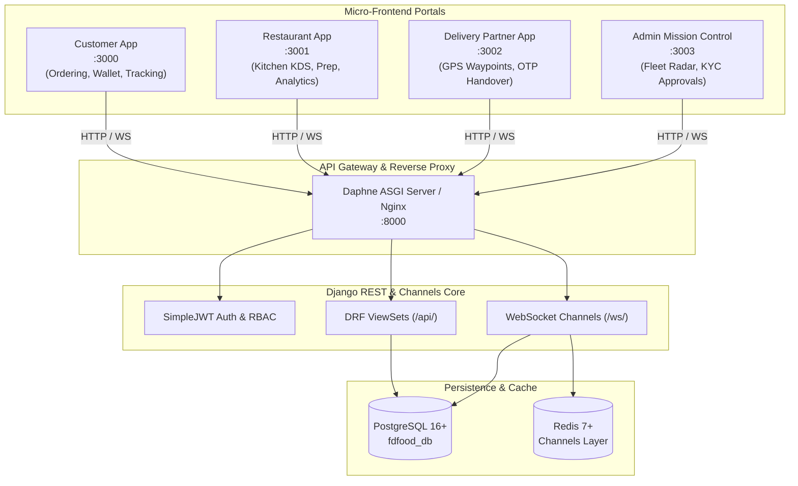

# FD Foods — Food Delivery Ecosystem

<div align="center">

**Fresh Choices. Royal Experiences.**<br>
*A modern, multi-tier food delivery ecosystem featuring four independent React 19 micro-frontends and a hardened Django Channels/PostgreSQL ASGI backend.*

[](https://github.com/Ravi-04-00/Food-Ecosystem/actions/workflows/ci.yml)
[](LICENSE)
[](https://react.dev/)
[](https://vitejs.dev/)
[](https://www.djangoproject.com/)
[](https://www.postgresql.org/)

</div>

---

## 1. Problem Statement & Project Goals

Modern on-demand food delivery platforms require seamless coordination across distinct user personas: consumers, kitchen staff, couriers, and administrators. Monolithic single-page architectures often suffer from permission leakage, bloated bundles, and fragile state synchronization.

**FD Foods** solves this with an isolated **micro-frontend architecture** and an event-driven **ASGI backend**:
- **Role Isolation**: 4 dedicated client applications operate with isolated ports, strict authentication boundaries, and bespoke user experiences.
- **Real-Time Telemetry**: Real-time order dispatch, driver waypoints, and customer order tracking via Django Channels and WebSockets.
- **Tamper-Proof Handover**: Cryptographic 4-digit OTP required before completing order handover.
- **Resilient Fallback**: Zero blank canvases — dual-engine interactive maps automatically switch to vector SVG mode when offline or without API keys.

---

## 2. Technology Stack

| Layer | Technologies |
| :--- | :--- |
| **Micro-Frontends** | React 19, Vite 8.3, Tailwind CSS v4, Lucide Icons, Three.js 3D Viewer (Lazy Loaded) |
| **Backend API** | Python 3.12–3.14, Django 5.x, Django REST Framework (DRF), SimpleJWT |
| **Real-Time & Concurrency** | Daphne (ASGI), Django Channels 4.x, Redis 7+ |
| **Database & ORM** | PostgreSQL 16+ with persistent connection pooling (`CONN_MAX_AGE=60`) |
| **Mapping & Geolocation** | Google Maps JavaScript API (with offline SVG vector fallback) |
| **Payment Gateway** | Razorpay Test Mode with HMAC-SHA256 signature verification |
| **DevOps & Tooling** | Docker, Docker Compose, Nginx, GitHub Actions, Node.js Test Runner |

---

## 3. Architecture & Ecosystem Flow



---

## 4. Repository Structure

```
FD-Foods/
├── frontend/                               # Independent React 19 / Vite Applications
│   ├── customer-app/                       # Port 3000: Consumer ordering & tracking portal
│   ├── restaurant-app/                     # Port 3001: Kitchen operations & SVG analytics
│   ├── delivery-partner-app/               # Port 3002: Courier dispatch & GPS telemetry
│   ├── admin-app/                          # Port 3003: Mission control & ecosystem radar
│   └── tests/                              # 75 automated frontend unit & QA test suites
├── backend/                                # Django 5.x REST API & Channels
│   ├── manage.py                           # Django CLI & server entry point
│   ├── requirements.txt                    # Pinned Python dependencies
│   ├── config/                             # settings.py, asgi.py, wsgi.py, urls.py
│   ├── apps/                               # 20 modular domain apps (accounts, orders, etc.)
│   ├── tests/                              # Automated Django backend test suite
│   ├── scripts/                            # Database backup and restore utilities (.py, .bat, .sh)
│   ├── deploy/ & nginx/                    # Production Daphne ASGI systemd & Nginx configs
│   ├── docs/                               # System design & architecture specifications
│   ├── media/                              # Mock catalog logos and food images
│   └── simulate_e2e_order_journey.py       # Multi-actor order simulation utility
├── .env.example                            # Clean, sanitized environment template
├── .gitignore                              # Comprehensive protection (secrets, SQL, media)
├── package.json                            # Root workspace orchestrator (dev:all, build:all, test)
├── package-lock.json                       # Verified package lockfile
├── README.md                               # Project documentation (this file)
├── start.bat                               # Windows 1-click batch launcher
├── start_all.ps1                           # Port-conflict-safe ecosystem launcher
├── docker-compose.yml                      # Production Docker orchestration
├── Dockerfile.frontend                     # Multi-stage frontend Dockerfile
├── CONTRIBUTING.md                         # Contribution and development guidelines
├── LICENSE                                 # Proprietary & Confidential license notice
├── SECURITY.md                             # Vulnerability disclosure & secrets policy
└── .github/                                # GitHub Actions CI & Issue Templates
    ├── workflows/ci.yml                    # Automated tests & multi-app build pipeline
    ├── ISSUE_TEMPLATE/                     # Bug & Feature issue templates
    └── PULL_REQUEST_TEMPLATE.md            # PR checklist and guidelines
```

---

## 5. Prerequisites & Quick Start

### System Requirements
- **Node.js**: `v18.0.0+` (v20+ LTS recommended)
- **Python**: `3.12` to `3.14`
- **PostgreSQL**: `16+` running on localhost:5432
- **Git**: Recent version

### Installation Steps

1. **Clone the repository:**
   ```bash
   git clone https://github.com/Ravi-04-00/Food-Ecosystem.git
   cd Food-Ecosystem
   ```

2. **Configure Environment Variables:**
   ```bash
   # Copy the sanitized template
   cp .env.example .env
   ```
   *(Update `.env` with your local PostgreSQL password if different from `root`)*

3. **Install Dependencies:**
   ```bash
   # Install frontend orchestration and dependencies
   npm install

   # Install backend Python requirements
   cd backend
   pip install -r requirements.txt
   cd ..
   ```

4. **Launch All Services (1-Click Orchestrator):**
   ```powershell
   # Windows PowerShell
   .\start_all.ps1
   ```
   *The launcher detects port availability, starts the Django ASGI server, and launches all 4 React applications concurrently.*

   **Or Launch Applications Individually:**
   ```bash
   # Individual frontend apps:
   npm run dev:customer     # http://localhost:3000
   npm run dev:restaurant   # http://localhost:3001
   npm run dev:delivery     # http://localhost:3002
   npm run dev:admin        # http://localhost:3003

   # Backend API:
   python backend/manage.py runserver 127.0.0.1:8000
   ```

---

## 6. Applications & Demo Credentials

| Application | Local URL | Role / Purpose | Default Demo Account |
| :--- | :--- | :--- | :--- |
| **Customer App** | [http://localhost:3000](http://localhost:3000) | Food ordering, real-time tracking, customer wallet, loyalty tiers | `customer@wsfood.io` / `wsfood123` |
| **Restaurant Partner** | [http://localhost:3001](http://localhost:3001) | Kitchen KDS, live dispatch, menu items, SVG analytics | `shop@wsfood.io` / `wsfood123` |
| **Delivery Partner** | [http://localhost:3002](http://localhost:3002) | Turn-by-turn routing, GPS telemetry, OTP verification | `rider@wsfood.io` / `wsfood123` |
| **Admin Command Center**| [http://localhost:3003](http://localhost:3003) | Fleet live radar, partner KYC approvals, dispute mediation | `admin@wsfood.io` / `wsfood123` |
| **Backend REST & WS** | [http://127.0.0.1:8000/api/](http://127.0.0.1:8000/api/) | Central REST API & Channels WebSocket consumers | Superuser: `admin` |
| **Swagger / OpenAPI Docs** | [http://127.0.0.1:8000/api/docs/](http://127.0.0.1:8000/api/docs/) | Interactive REST API Documentation | Any authenticated user |

---

## 7. Automated Testing & Verification

Every component is validated by automated test suites:

```bash
# 1. Frontend Test Suite (75 Tests: auth, cart isolation, error handling, PWA, 14 viewports)
npm run test:frontend

# 2. Production Multi-App Build (Verifies zero bundle or module syntax errors across all 4 apps)
npm run build:all

# 3. Backend Test Suite (Models, RBAC, checkout, refunds, OTP, Channels)
cd backend
python manage.py check
python manage.py test apps.core_tests --keepdb

# 4. Multi-Actor Live Order Journey Simulation (Simulates 7-stage order lifecycle in ~17s)
python simulate_e2e_order_journey.py
```

---

## 8. Security & Secret Protection

- **Zero Tracked Secrets**: Real API secrets, private keys, and passwords are excluded by `.gitignore` and enforced via pre-commit audit standards.
- **Database Safety**: Raw database dumps (`*.sql`, `*.dump`) and user KYC records are permanently excluded from Git tracking.
- **Frontend Isolation**: Variables exposed to browser bundles must be explicitly prefixed with `VITE_`. Server credentials (Django `SECRET_KEY`, database credentials, Razorpay Key Secret) must never be accessible to the client.

For reporting security vulnerabilities, refer to [SECURITY.md](SECURITY.md).

---

## 9. License

This project is proprietary and confidential. See [LICENSE](LICENSE) for full legal terms.
Copyright &copy; 2026 FD Foods. All rights reserved.
