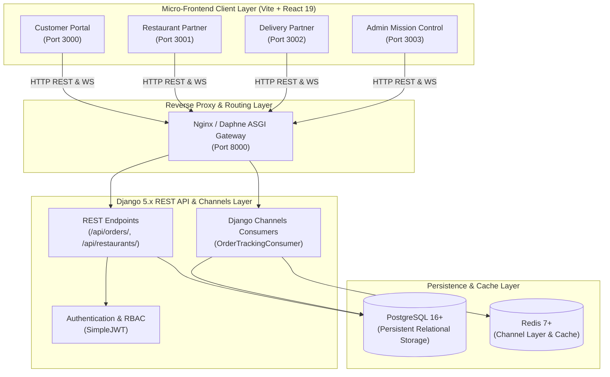
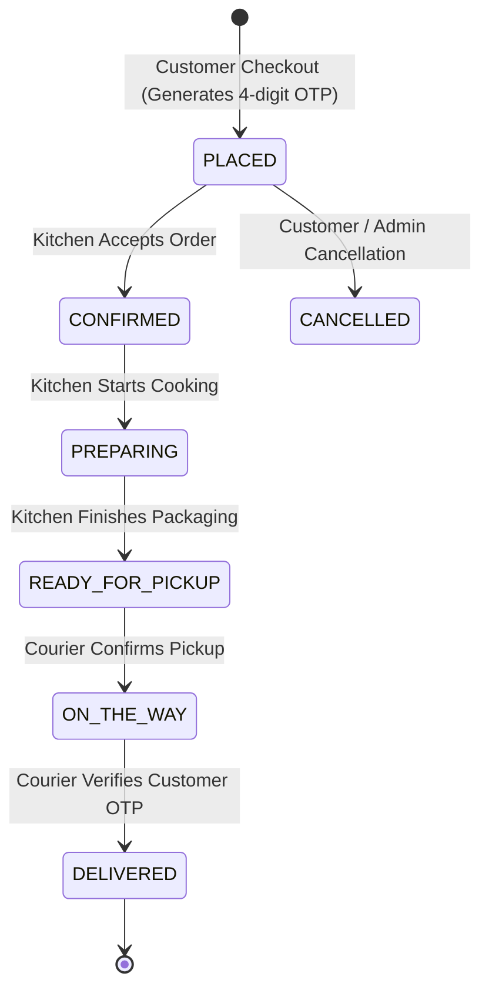

# FD Foods — Technical Architecture & System Design

This document details the architectural boundaries, communication protocols, state machines, and database models governing the **FD Foods** food delivery ecosystem.

---

## 1. High-Level System Overview



---

## 2. Micro-Frontend App Boundaries

| Application | Port | Framework | Primary Domain Responsibilities |
| :--- | :--- | :--- | :--- |
| **Customer App** | `3000` | React 19 / Vite | Restaurant discovery, dish customization, single-restaurant cart isolation, address pin drop, payment execution, live order tracking with OTP handover, FD Wallet, and loyalty referral ledger. |
| **Restaurant App** | `3001` | React 19 / Vite | Live kitchen display system (KDS), dispatch queue alerts, 4-stage cooking pipeline, dish availability toggle, operating hours, SVG sales analytics, and payout ledger. |
| **Delivery Partner App**| `3002` | React 19 / Vite | Shift management, job board acceptance, turn-by-turn waypoint routing, 10-second throttled GPS telemetry broadcasting, pickup confirmation, and customer OTP delivery verification. |
| **Admin App** | `3003` | React 19 / Vite | Platform-wide operational radar, live courier tracking, restaurant onboarding and KYC verification, SLA delay monitoring, dispute mediation, and commission payouts. |

---

## 3. Order Lifecycle State Machine

Every order transitions through a strictly validated state machine enforced by backend DRF views:



### State Machine Constraints:
1. **Cryptographic OTP Handover**: An order cannot transition to `DELIVERED` without valid verification of the 4-digit OTP supplied by the customer.
2. **Single-Restaurant Isolation**: Customers cannot mix items from multiple restaurants in a single cart session. Adding items from a new restaurant prompts a clear conflict resolution dialog.
3. **Idempotent Mutations**: Checkout and payment submission endpoints implement double-click protection and state locks to prevent duplicate billing.

---

## 4. Real-Time Telemetry & WebSocket Protocol

Real-time location and status updates are powered by **Django Channels** and backed by **Redis**:

- **Protocol**: Standard WebSocket (`ws://` dev, `wss://` prod) connecting to `/ws/orders/<order_id>/` and `/ws/fleet/radar/`.
- **Telemetry Throttling**: Delivery partner location updates are throttled to 10-second intervals to minimize battery drain and network saturation while preserving fluid marker motion.
- **Envelope Format**:
  ```json
  {
    "type": "location_update",
    "order_id": 42,
    "rider_id": 12,
    "latitude": 12.9716,
    "longitude": 77.5946,
    "heading": 184.5,
    "speed_kmh": 28.2,
    "timestamp": "2026-10-27T18:45:00Z"
  }
  ```
- **Fallback Resilience**: In offline or disconnected states, clients employ exponential backoff with jitter and retain last-known coordinates.

---

## 5. Security Architecture & RBAC

- **Authentication**: Stateless JSON Web Tokens (JWT) using `rest_framework_simplejwt`. Access tokens expire in 1 day; refresh tokens expire in 7 days and are rotated on every refresh.
- **Role-Based Access Control (RBAC)**: Custom DRF permission classes (`IsCustomerUser`, `IsRestaurantStaff`, `IsDeliveryPartner`, `IsAdminRole`) guard domain-specific endpoints.
- **Sensitive Data Isolation**: Database passwords, payment gateway secrets, and cryptographic keys are loaded exclusively from server environment variables and never bundled into frontend assets.
